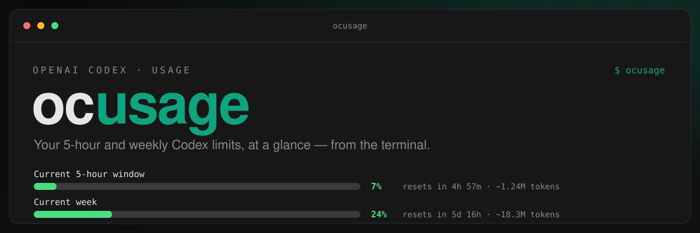

<div align="center">



<p>
  <a href="LICENSE"></a>
  = 18" src="https://img.shields.io/badge/node-%3E%3D18-4ADE80.svg">
  
  
  
  
</p>

</div>

# ocusage

A colorful, cross-platform command-line dashboard for your **OpenAI Codex**
usage. Run `ocusage` and instantly see how much of your 5-hour and weekly
Codex allowance is used, and when each window resets.

```
  Codex · usage
  you@example.com · Plus                       fetched 2026-09-06 03:49

  Current 5-hour window
  ██░░░░░░░░░░░░░░░░░░░░░░░░░░    7%      resets in 4h 57m · ~1.24M tokens

  Current week
  ███████░░░░░░░░░░░░░░░░░░░░░   24%      resets in 5d 16h · ~18.3M tokens
```

It uses the login the Codex CLI already has and asks the same usage service
Codex's own `/status` command polls — no separate login, no API key to
configure. `ocusage` is the OpenAI Codex sibling of
[ccusage](https://github.com/zachisparanoid/ccusage) (the Claude Code
version): same flags, same exit codes, same `--json` contract.

## What it shows

Every run surfaces the two windows Codex meters:

- **Current 5-hour window** — the rolling "5h limit" Codex shows in `/status`.
- **Current week** — the weekly limit, counted across every model.

When the service reports more (a separate code-review limit, or additional
named limits) those are shown too, after the two above. If your account has
prepaid credits, the balance appears on the header line.

The `~1.24M tokens` hint next to each percentage is how many tokens your
local Codex session logs recorded since that window opened. OpenAI never
exposes the actual cap, so this is the only way to get a feel for what a
percentage point costs you. It's a local, best-effort count (marked with `~`)
and only covers sessions run on this machine.

## Install

`ocusage` isn't published to a registry yet — clone the repo, build it, and
link it onto your `PATH`. This works the same way on Windows, macOS, and
Linux; there's no OS-specific install step because the whole tool is plain
Node.js.

```sh
git clone https://github.com/zachisparanoid/ocusage.git
cd ocusage
npm install
npm run build      # emits dist/cli.js
npm link           # puts `ocusage` on your PATH
```

`npm link` requires a shell with npm's global bin directory on `PATH`
(the default on most setups). Once linked, running `ocusage` from any
directory works. To remove it later, run `npm unlink -g ocusage`.

Requires **Node.js 18 or newer** and a Codex CLI that has been signed in
with a ChatGPT account (`codex login`).

## Usage

```
ocusage [options]
```

| Flag                   | What it does                                                                                      | Example                         |
| ---------------------- | ------------------------------------------------------------------------------------------------- | ------------------------------- |
| _(none)_               | Show the colored usage dashboard                                                                  | `ocusage`                       |
| `--json`               | Print the usage report as JSON — no color, ever. The integration surface for scripts/status bars. | `ocusage --json`                |
| `--watch`              | Clear the screen and repaint on an interval until Ctrl-C                                          | `ocusage --watch`               |
| `--interval <seconds>` | Repaint interval for `--watch`, in seconds (default `60`, floor `5`)                              | `ocusage --watch --interval 15` |
| `--compact`            | One line per window, no header — good for embedding in a status line                              | `ocusage --compact`             |
| `--source <mode>`      | Force a data source: `auto` (default), `api`, or `local`                                          | `ocusage --source local`        |
| `--no-color`           | Disable ANSI colors                                                                               | `ocusage --no-color`            |
| `-V, --version`        | Print the installed version                                                                       | `ocusage --version`             |
| `-h, --help`           | Show usage help with examples                                                                     | `ocusage --help`                |

Color is also auto-disabled when stdout isn't a TTY (e.g. piped to a file)
or when the `NO_COLOR` environment variable is set to anything, and can be
force-enabled with `FORCE_COLOR=1` even when piped.

Set `CODEX_HOME` to point at a non-default Codex directory — `ocusage`
honors the same override the `codex` binary does.

### `--json` output

```jsonc
{
  "account": { "email": "you@example.com", "plan": "Plus" },
  "credits": { "hasCredits": false, "unlimited": false, "balance": "0" },
  "windows": [
    {
      "id": "session_5h",
      "label": "Current 5-hour window",
      "used": 7,
      "limit": null, // OpenAI only exposes percentages, never the cap
      "unit": "ratio",
      "percentUsed": 7,
      "resetsAt": "2026-09-06T12:46:35.000Z",
      "windowSeconds": 18000,
      "localTokens": 1240000, // from local session logs; null when unavailable
      "source": "api",
      "estimated": false,
    },
    // ...week_all, and any extra windows the service returned
  ],
  "fetchedAt": "2026-09-06T07:49:20.000Z",
  "asOf": "2026-09-06T07:49:20.000Z", // when the numbers were recorded
  "source": "api",
  "warnings": [],
}
```

`session_5h` and `week_all` are the same ids `ccusage` uses for the same
concepts, so one status-bar script can read both tools.

On failure, `--json` always writes one JSON document to stdout — never a
bare stderr line — so scripts never need to parse stderr to know what
happened: `{"error": "no_data", "message": "..."}`, with the matching exit
code (see below).

## Data sources and trust level

`ocusage` tries two sources, in this order under the default `--source auto`:

1. **Live service** (`source: "api"` in the report) — the account usage
   endpoint the Codex CLI itself polls for its `/status` limits,
   authenticated with the ChatGPT login stored by `codex login`. This is
   authoritative: real percentages against your actual plan limits, real
   reset times.
2. **Local session logs** (`source: "local"`, every window marked
   `"estimated": true`) — a fallback used when the live service is
   unavailable (offline, signed out, an expired token). Codex writes the
   server's rate-limit answer into every session log
   (`~/.codex/sessions/**/rollout-*.jsonl`) each time it hears back, so the
   fallback shows the **newest snapshot it can find** — real percentages,
   just possibly stale — and the warning line says how old it is. A window
   whose reset time has already passed shows `0%` with a note rather than
   a stale number. If there is no snapshot at all, only raw token counts
   from the trailing 5 hours / 7 days are shown, with `0%` bars and
   `limit: null`.

Force one or the other with `--source api` / `--source local` if you want
to skip the fallback behavior entirely.

`ocusage` never refreshes or rewrites your Codex login. If the token has
expired, just run Codex once — it refreshes on use.

## Troubleshooting

**"Not signed in to Codex and no local session data found."**
Neither a ChatGPT login nor any local session history could be found. Run
`codex login` (or use Codex for a session so there's local history), then
try again. Exit code `2`.

**"Your Codex login token appears expired."**
Your local `auth.json` exists but the access token has expired. Under the
default `--source auto` this is silent — `ocusage` shows the last local
snapshot with a warning. Under `--source api` it's a hard error. Run Codex
once (or `codex login`) to refresh the token. Exit code `2`.

**"Codex is signed in with an API key…"**
Usage windows only exist for ChatGPT-plan sign-ins; an API-key sign-in is
billed per token instead. `ocusage` shows local session data only.

**"Could not reach the usage service (timed out)."**
The live service didn't respond within 10 seconds. Under `auto` this falls
back to the local snapshot automatically; under `--source api` it's a hard
error (exit code `3`). Check your network connection, or just run with
`--source local`.

**Numbers look stale / a bar is stuck at 0%.**
That's the local-log fallback (see above) — it's activated automatically
whenever the live service isn't reachable, and always says so via a
warning line that includes the snapshot's age. Running Codex refreshes it.

**Every error prints one line to stderr and exits non-zero** — `2` for
"not authenticated / no data", `3` for network failures, `1` for anything
unexpected. `--json` mode never uses stderr; failures come back as JSON on
stdout instead, with the same exit codes.

## Development

```sh
npm test          # vitest
npm run typecheck # tsc --noEmit
npm run lint       # eslint (does not block the build)
npm run format     # prettier --write
npm run dev        # tsup --watch
```

Source layout:

```
src/
  cli.ts                # entry: commander setup, routing, top-level error boundary
  commands/              # show (default), json, watch
  core/                  # paths, credentials (auth.json + JWT claims), api/local sources,
                         #   window naming, normalize, reset math
  render/                # colors, number formatting, progress bar, dashboard layout
  types.ts               # UsageReport / UsageWindow / CliOptions contract
  errors.ts              # typed errors mapped to exit codes
test/                    # vitest unit + snapshot tests, with fixtures/
docs/superpowers/specs/  # design doc, including the reverse-engineered Codex data formats
```

`core/apiSource.ts` and `core/localSource.ts` both produce a common
`RawUsageData` shape; `core/normalize.ts` is the only place percentages get
computed, so percent math (clamping, divide-by-zero safety) only has to be
correct in one place. All `render/*` functions are pure (`UsageReport` in,
`string` out) so they're snapshot-testable without a real terminal.

The exact shapes of `auth.json`, the usage service response, and the
session rollout lines — none of which OpenAI documents — are written up in
[the design doc](docs/superpowers/specs/2026-09-06-ocusage-design.md) and
in comments next to the code that parses them.

## Contributing

Issues and pull requests are welcome. Before opening a PR, please run the
full check suite:

```sh
npm run typecheck
npm run lint
npm test
```

## Disclaimer

`ocusage` is an unofficial, community-built tool. It is not affiliated with,
endorsed by, or supported by OpenAI. It reads only local Codex state on your
own machine and talks to the same account usage endpoint the official Codex
CLI uses. Response shapes from that endpoint are undocumented and may change
at any time; when they do, `ocusage` falls back to a local snapshot rather
than breaking.

## License

[MIT](LICENSE) © zachisparanoid
